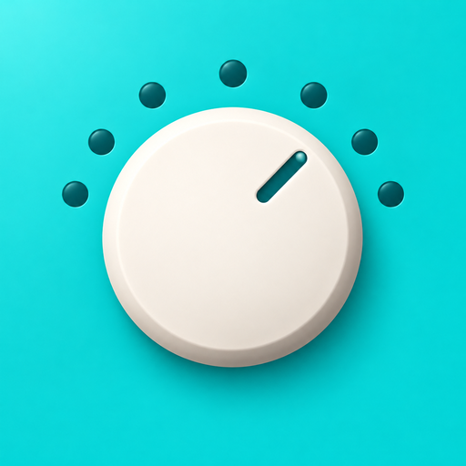
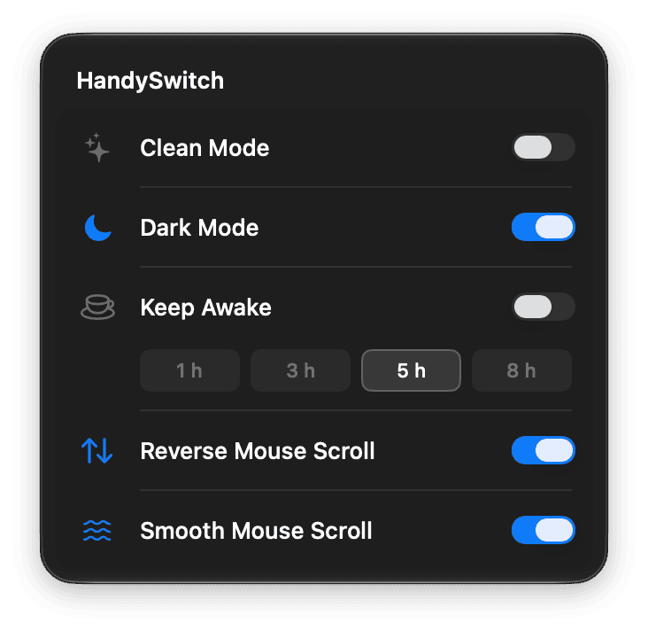

**Languages:** English | [简体中文](README.zh-CN.md)

<p align="center">
  
  <h1 align="center">HandySwitch</h1>
  <p align="center">
    <strong>Five everyday macOS toggles in one tiny menu bar icon.</strong><br>
    Dark Mode · Prevent Sleep · Clean Mode · Reverse & Smooth Mouse Scroll
  </p>
  <p align="center">
    <a href="https://github.com/x0c/HandySwitch/releases/latest"></a>
    <a href="LICENSE"></a>
    
  </p>
</p>

Instead of cluttering your menu bar with separate apps for keeping your Mac awake, fixing external mouse scrolling, locking the keyboard for cleaning, and toggling dark mode, **HandySwitch** puts the five switches you actually use every day under a single native menu bar icon.

No feature bloat, no Dock icon, no accounts, and zero telemetry.

**Requires macOS 14 (Sonoma) or later** (Apple silicon and Intel). Open source under the MIT License.

<p align="center">
  
</p>

---

## ✨ The 5 Toggles

| Toggle | What it does |
| :--- | :--- |
| **🧹 Clean Mode** | Blacks out all displays and blocks keyboard/mouse input so you can safely wipe your screen and keys. Hold **`Esc` for 3 seconds** to exit. |
| **🌗 Dark Mode** | Switches macOS system-wide Light and Dark appearance in one click without opening System Settings. |
| **☕ Prevent Sleep** | Keeps your Mac awake indefinitely or for a preset timer while downloading, rendering, or running long tasks. |
| **🖱️ Reverse Mouse Scroll** | Reverses external mouse wheel direction while keeping your MacBook trackpad's natural scrolling intact. |
| **🌊 Smooth Mouse Scroll** | Smooths out notched external mouse wheel steps without needing complex per-app profiles. |

---

## 📦 Install

### Homebrew (recommended)

```bash
brew install --cask x0c/tap/handy-switch
```

### Direct download (DMG)

Download the latest **signed and notarized** `HandySwitch-x.y.z.dmg` from [Releases](https://github.com/x0c/HandySwitch/releases/latest) and drag **HandySwitch** to `/Applications`.

HandySwitch includes built-in automatic updates via [Sparkle](https://sparkle-project.org) (**Right-click menu bar icon → Check for Updates…**).

<details>
<summary><strong>Build from source (Xcode)</strong></summary>

Requires Xcode and [XcodeGen](https://github.com/yonaskolb/XcodeGen):

```bash
git clone https://github.com/x0c/HandySwitch.git
cd HandySwitch
xcodegen generate
xcodebuild -project HandySwitch.xcodeproj -scheme HandySwitch -configuration Release \
  -destination 'platform=macOS' -derivedDataPath build/DerivedData build
ditto build/DerivedData/Build/Products/Release/HandySwitch.app /Applications/HandySwitch.app
open /Applications/HandySwitch.app
```
</details>

---

## 💡 Usage & Permissions

1. **Left-click** the menu bar icon to open the switch panel; click outside to dismiss.
2. **Right-click** the icon for **Open Main Window**, **Launch at Login**, **Check for Updates…**, or **Quit**.
3. **On-demand permissions:**
   - **Clean Mode** and **Mouse Scroll** toggles require **Accessibility** permission.
   - **Dark Mode** requires **Automation (System Events)** permission.
   - Permissions are only requested when you turn on the corresponding toggle. If a switch cannot activate, click the in-app shortcut to open System Settings.
4. In Clean Mode, hold **Esc** for about three seconds to exit (the only exit gesture).
5. Launch at login is off by default. Login launches stay silent (no window).

---

## 🍎 More Native macOS & Developer Tools

| Project | Description |
| :--- | :--- |
| **[MacResourceMonitor](https://github.com/x0c/MacResourceMonitor)** | Lightweight menu bar CPU monitor — see which process is eating CPU and terminate it in one click. |
| **[NeatPaste](https://github.com/NeatMacApps/NeatPaste)** & **[NeatEditor](https://github.com/NeatMacApps/NeatEditor)** | Fast, native clipboard manager and minimalist editor for macOS. |
| **[Corral](https://github.com/corral-dev/corral-apple)** | Run Claude Code, Codex, and Cursor side by side and continue sessions from native Mac & iPhone clients. |
| **[subswap](https://github.com/x0c/subswap)** & **[agentsync](https://github.com/x0c/agentsync)** | Multi-account quota switcher and unified config/MCP sync CLI for AI coding agents. |

## License

[MIT](LICENSE)
