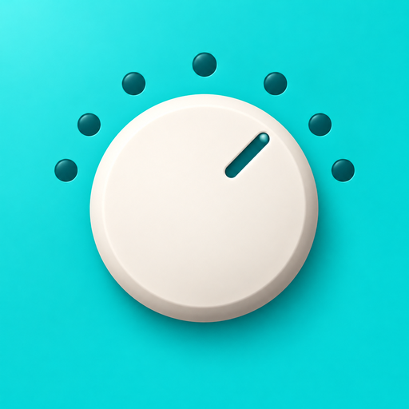
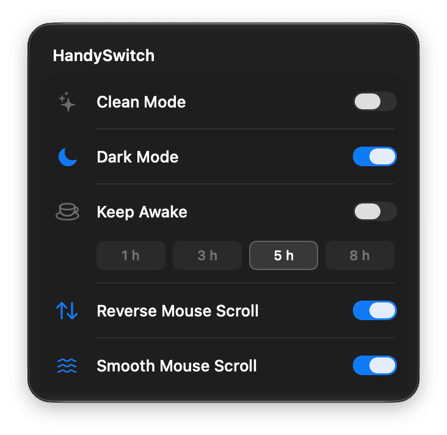

**语言：** [English](README.md) | 简体中文

<p align="center">
  
  <h1 align="center">HandySwitch</h1>
  <p align="center">
    <strong>一个小小的菜单栏图标，装下五个每天都要用的 macOS 开关。</strong><br>
    深色模式 · 防止睡眠 · 清洁模式 · 鼠标滚轮反转与平滑
  </p>
  <p align="center">
    <a href="https://github.com/x0c/HandySwitch/releases/latest"></a>
    <a href="LICENSE"></a>
    
  </p>
</p>

以前为了「防止睡眠」要装一个常驻、防「外接鼠标滚轮反人类」要装一个、擦屏幕锁键盘又要装一个——3 个软件占 3 个菜单栏位。**HandySwitch** 把每天真正高频使用的 5 个开关，浓缩进 1 个原生菜单栏图标里。

没有功能超市，没有程序坞图标，没有账号，零遥测。

**需要 macOS 14（Sonoma）或更高版本**（Apple 芯片与 Intel）。以 MIT 许可证开源。

<p align="center">
  
</p>

---

## ✨ 五个开关

| 开关 | 作用 |
| :--- | :--- |
| **🧹 清洁模式** | 全黑遮罩盖住所有屏幕并拦截键盘 / 鼠标输入，放心擦屏幕、擦按键。按住 **`Esc` 三秒**退出。 |
| **🌗 深色模式** | 一键切换 macOS 全系统浅色 / 深色外观，不用打开系统设置。 |
| **☕ 防止睡眠** | 下载、渲染、跑长任务时让 Mac 保持唤醒，可常开，也可按预置时长自动关闭。 |
| **🖱️ 鼠标滚轮反转** | 只反转外接鼠标滚轮方向，MacBook 触控板的自然滚动方向保持不变。 |
| **🌊 鼠标滚轮平滑** | 把一格一格的外接鼠标滚轮变成更连续的滚动，不需要复杂的按应用配置。 |

---

## 📦 安装

### Homebrew（推荐）

```bash
brew install --cask x0c/tap/handy-switch
```

### 直接下载（DMG）

从 [Releases](https://github.com/x0c/HandySwitch/releases/latest) 下载最新的**已签名并公证**的 `HandySwitch-x.y.z.dmg`，把 HandySwitch 拖进「应用程序」。

HandySwitch 通过 [Sparkle](https://sparkle-project.org) 内置自动更新（**右键点菜单栏图标 → 检查更新…**）。

<details>
<summary><strong>从源码构建（Xcode）</strong></summary>

需要 Xcode 与 [XcodeGen](https://github.com/yonaskolb/XcodeGen)：

```bash
git clone https://github.com/x0c/HandySwitch.git
cd HandySwitch
xcodegen generate
xcodebuild -project HandySwitch.xcodeproj -scheme HandySwitch -configuration Release \
  -destination 'platform=macOS' -derivedDataPath build/DerivedData build
ditto build/DerivedData/Build/Products/Release/HandySwitch.app /Applications/HandySwitch.app
open /Applications/HandySwitch.app
```
</details>

---

## 💡 用法与权限

1. **左键**点菜单栏图标，在图标下方打开开关浮层；点外面关闭。
2. **右键**点图标，可打开主窗口、开机自启、检查更新或退出。
3. **按需申请权限：**
   - **清洁模式**与鼠标滚轮相关开关需要**辅助功能**权限。
   - **深色模式**需要**自动化**（System Events）权限。
   - 只有当你打开对应开关时才会申请权限。打不开时按应用内提示去系统设置授权。
4. 清洁模式中，按住 **Esc** 约三秒退出（唯一出口）。
5. 开机自启默认关闭；登录项拉起时保持静默（不弹窗）。

---

## 🍎 更多原生 macOS 与开发者工具

| 项目 | 简介 |
| :--- | :--- |
| **[MacResourceMonitor](https://github.com/x0c/MacResourceMonitor)** | 轻量菜单栏 CPU 监视器——一眼看出哪个进程在吃 CPU，一键结束它。 |
| **[NeatPaste](https://github.com/NeatMacApps/NeatPaste)** 与 **[NeatEditor](https://github.com/NeatMacApps/NeatEditor)** | 又快又原生的 macOS 剪贴板管理器与极简编辑器。 |
| **[Corral](https://github.com/corral-dev/corral-apple)** | 把 Claude Code、Codex 和 Cursor 排排坐，在 Mac 与 iPhone 原生客户端里接着聊。 |
| **[subswap](https://github.com/x0c/subswap)** 与 **[agentsync](https://github.com/x0c/agentsync)** | AI 编程助手的多账号额度切换器与统一配置 / MCP 同步 CLI。 |

## 许可证

[MIT](LICENSE)
